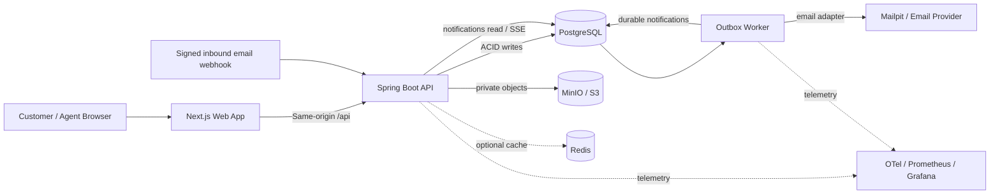

# HELIOS DESK — Enterprise Helpdesk & Ticket Management Platform

**Document:** `PROJECT_SPEC.md`  
**Audience:** Coding agents (Codex), reviewers, future maintainers, hiring managers  
**Language:** English — all source code, UI copy, documentation, tests, commits, and comments should be in English.  
**Status:** Implementation specification, not a claim that any functionality already exists.  
**Product version:** 1.0 specification  
**Updated:** 2026-11-12

> **Codex mandate:** Build a working, demonstrable, production-minded full-stack application—not a static UI, a CRUD scaffold, or a collection of placeholder endpoints. Implement in the phases below, beginning with a complete vertical slice. Never silently skip a required acceptance criterion. Keep the app runnable, tested, and documented after each phase. Use synthetic demo data only.

---

## 0. Executive summary and non-negotiable design decisions

**Product:** Helios Desk, a multi-tenant customer-support SaaS for companies to manage inbound requests from a customer portal and email, prioritize and assign tickets, respond from an agent workspace, meet configurable service-level agreements (SLAs), analyze performance, and audit activity.

**Primary result:** A reviewer should be able to clone the repository, start its Docker-based dependencies and applications, log in as three different personas, create a ticket, assign it to an agent, add a public reply and a private internal note, see an SLA clock progress correctly, receive a real-time notification, resolve the ticket, and inspect the audit trail. All business data must be genuinely persisted and authorized.

### Architectural decisions (ADRs to record under `/docs/adr`)

| ID | Decision | Rationale |
|---|---|---|
| ADR-001 | Modular monolith, not microservices | Strong domain boundaries without distributed transaction overhead; portfolio demonstrates good judgment. |
| ADR-002 | Next.js App Router + React + TypeScript for web; Java 21+ + maintained compatible Spring Boot release for API | Mature full-stack stack, type safety, robust Spring Security/JPA support. Pin exact tested compatible releases in lockfiles/build config. |
| ADR-003 | PostgreSQL is the system of record; Flyway owns all schema migrations | ACID transactions, constraints, concurrency control, reproducible environments. |
| ADR-004 | Opaque HttpOnly secure cookie-backed sessions (Spring Security + JDBC-backed sessions) with CSRF protection | Simpler revocation and browser security than inventing a custom JWT-refresh flow; stateless JWT not required for core MVP. |
| ADR-005 | `tenant_id` isolation is mandatory on every tenant-owned record and query | Prevent cross-customer data exposure; verify with negative security tests. |
| ADR-006 | Optimistic versioning for ticket edits; row locks for sequence allocation and worker claims | Prevent lost updates and duplicate work. |
| ADR-007 | Transactional outbox and idempotent delivery for side effects | A successful ticket commit must not lose a notification/email on process crash. |
| ADR-008 | Server-sent events (SSE) + durable notification stream for live UI | Simpler than WebSocket for one-way updates; reconnect and replay supported. |
| ADR-009 | Postgres full-text search for v1 | Avoid introducing Elasticsearch before scale demands it. |
| ADR-010 | MinIO/S3-compatible private object storage for uploads; quarantine/scanning gateway | Files are not public assets; separate storage and validation controls. |
| ADR-011 | Automated testing is a release criterion | Critical business rules must have unit, integration, E2E, and failure-path tests. |
| ADR-012 | Accessibility and responsive UI are baseline requirements | Agent productivity and usable customer portal on common screen sizes. |

**Explicit tradeoff:** The project targets production-like correctness and operational thinking. It is not being represented as a formally security-certified or proven high-scale production service. Performance goals below are measurable targets to validate, not guaranteed claims.

## 1. Goals, personas, scope, success criteria

### 1.1 Product goals

- Centralize customer support requests from a web portal and a provider-agnostic inbound-email adapter.
- Provide fast queue triage, assignment, response, collaboration, and resolution.
- Enforce server-side authorization across company tenants and customer roles.
- Calculate business-hour SLAs with holiday/time-zone awareness.
- Produce an immutable-looking, append-only audit trail (application-level immutability with operational retention controls).
- Demonstrate resilience under duplicate requests, retries, concurrent edits, email failures, and worker crashes.
- Make project demonstrable entirely with local demo infrastructure; external paid services are optional.

### 1.2 Personas

1. **Platform operator (DEMO ONLY):** Maintains local environment; not permitted to read tenant tickets via normal app API. A real platform-admin capability is out of v1 scope.
2. **Tenant owner:** Controls subscription-independent tenant profile, users, teams, security settings, and SLAs.
3. **Tenant admin:** Manages team members, categories, mailbox connection, templates, and dashboards.
4. **Support manager:** Manages team queues, assigns tickets, adjusts priorities, views reports, escalates breaches.
5. **Support agent:** Works assigned/shared queues, replies to customers, adds private notes, changes allowed statuses, views knowledge articles.
6. **Customer/requester:** Creates and follows their own tickets, submits public messages and allowed attachments, rates resolved tickets.
7. **Auditor (read-only):** Views tenant ticket activity, reports, and audit records but never private secrets; audit access follows explicit policy below.

### 1.3 In scope

Tenant/workspace onboarding; login/logout/password resets; memberships/roles/teams; customer accounts; tickets; comments and notes; assignment; priority/categories/tags; internal collaboration; multi-status workflow; attachments; SLA policy and calendar; notifications/SSE; email channel; search; filters; dashboards; knowledge base; automation rules/macros; CSAT; audit; dev seed; tests; CI/CD; observability; incident runbooks.

### 1.4 Not in initial release

Billing/Stripe, phone/VoIP integration, social media channels, mobile native apps, AI-generated replies, external SSO/SAML, microservice decomposition, cross-region active-active, live collaborative document editing, real customer data. Future features can be added via ADRs without undermining core correctness.

### 1.5 Phases and release definitions

| Phase | Label | Required vertical outcome | Gate |
|---|---|---|---|
| P0 | Foundations | Monorepo, CI, Docker, auth, tenant boundaries, migrations, UI shell | Dev and test commands work on clean clone. |
| P1 | **Core MVP** | Customer opens ticket; agent triages, comments, resolves; filtering, timeline, auditing | All core scenarios and authorization E2E pass. |
| P2 | Service operations | Teams, ownership, SLA calendars, queue counters, SSE, notifications, reporting | SLA edge cases and outbox replay tests pass. |
| P3 | Omnichannel and efficiency | Inbound/outbound email, attachments, search, KB, macros, CSAT | Replay-safe integrations and file security tests pass. |
| P4 | Production hardening | Resilience drills, monitoring, load tests, backup/restore, deployment docs, demo video | Production scenarios and release checklist pass. |
| P5 | Stretch (optional) | Automation rule builder, custom fields, collision detection, advanced insights, tenant-level feature flags | Only after P0–P4 are complete. |

**Strict requirement:** Finish P0 and P1 completely before widening the number of modules. Core workflow quality has priority over feature count.

## 2. Technical stack and repository architecture

### 2.1 Required technologies

- **Frontend:** Next.js App Router, TypeScript strict mode, React, Tailwind CSS, shadcn/ui primitives, TanStack Query for client fetching/cache, React Hook Form + Zod for input validation, TanStack Table for server-paginated grids, date-fns/date-fns-tz or equivalent tested timezone utilities, Recharts for charts, lucide icons.
- **Backend:** Java 21 or another supported LTS, a maintained Spring Boot version compatible with selected Java, Spring MVC, Spring Security, Spring Data JPA for aggregate persistence (SQL/jOOQ/JdbcTemplate permitted for complex reports/worker claims), Bean Validation, Flyway, Spring Actuator, springdoc OpenAPI where compatible.
- **Data:** PostgreSQL; Redis only for optional cache/rate-limit acceleration; PostgreSQL remains canonical. Object storage: MinIO in local Docker; S3-compatible production abstraction.
- **Sessions:** Spring Security with Spring Session JDBC and CSRF defenses; same-origin app/API via reverse proxy or frontend rewrites with correct cookie behavior.
- **Async:** PostgreSQL transactional outbox + scheduled/background dispatch worker; optional RabbitMQ after this baseline is stable. Development outgoing email via Mailpit (or compatible local catcher).
- **Observability:** Structured JSON application logs, correlation IDs, Micrometer metrics, OpenTelemetry traces, Prometheus, Grafana; optional local OTEL collector/Tempo as separate compose profile.
- **Testing:** JUnit 5, AssertJ, Mockito for unit tests, Spring Boot Test + Testcontainers PostgreSQL for integrations, Playwright for E2E, Vitest/React Testing Library for UI, k6 for load profiles.
- **DevOps:** Docker, Docker Compose, GitHub Actions, dependency/security scanning, env templates, Makefile or `justfile`, explicit health checks.

Do not randomly replace the chosen stack with Supabase, Firebase, a BaaS, in-memory array storage, or an unrelated generator. Do not invent configuration API compatibility; resolve versions against package/build tools during implementation.

### 2.2 Logical system diagram



### 2.3 Backend module boundaries

The backend is one deployable Spring Boot app, organized by domain rather than one giant `service` directory:

- `identity`: sessions, users, password flows, tenant membership.
- `tenancy`: tenant lookup, tenant-scoped authorization, provisioning.
- `tickets`: ticket aggregate, status, priority, lifecycle, assignments, tags.
- `conversations`: public replies, private notes, immutable timeline records.
- `servicelevels`: business calendars, SLA targets, clocks, breach evaluation.
- `notifications`: user notifications and durable SSE feed.
- `mail`: provider adapter, signed inbound webhook, email send retries.
- `files`: upload, quarantine, scanning, storage authorization, downloads.
- `knowledge`: categories, draft/published articles, customer visibility.
- `automation`: macros and optional rules.
- `reporting`: aggregated tenant reports, exports.
- `audit`: append-only audit writer and query interface.
- `platform`: cross-cutting error handling, outbox, idempotency, tracing, health, common types.

**Boundary rule:** Controllers call application services; application services enforce auth and orchestrate transactions; repositories store domain state; worker side effects happen after transaction commit via outbox. A module must not directly mutate another module's database tables behind its contract.

### 2.4 Suggested monorepo

```text
helios-desk/
├── README.md
├── PROJECT_SPEC.md
├── AGENTS.md
├── LICENSE
├── .env.example
├── .github/workflows/{ci.yml,security.yml}
├── apps/
│   ├── web/                # Next.js, typed API client, ui tests
│   │   ├── app/
│   │   ├── components/
│   │   ├── features/
│   │   ├── lib/
│   │   └── e2e/
│   └── api/                # Spring Boot (Gradle or Maven, pick one)
│       ├── src/main/java/.../{identity,tenancy,tickets,...}
│       ├── src/main/resources/db/migration/
│       └── src/test/
├── packages/
│   └── api-contract/       # generated TypeScript types from checked-in OpenAPI
├── infra/
│   ├── docker/
│   ├── compose.yml
│   ├── monitoring/
│   └── k6/
├── docs/
│   ├── architecture.md
│   ├── erd.md
│   ├── api.md
│   ├── threat-model.md
│   ├── deployment.md
│   ├── demo-script.md
│   ├── adr/
│   └── runbooks/
├── scripts/
│   ├── seed-demo.sh
│   ├── verify.sh
│   └── reset-local.sh
└── Makefile
```

### 2.5 Runtime environments

- `dev`: local Docker dependencies + API + web with hot reload; synthetic fixtures; Mailpit; fake inbound email webhook test harness.
- `test`: isolated database per integration suite; deterministic clocks; no external internet required.
- `staging`: production-like containers, migrations, private objects, observability, generated test users.
- `production-example`: documented reference deployment; no real secrets or paid infrastructure needed to review code.

**One-command goal:** `docker compose -f infra/compose.yml up --build` must launch the full runnable demo, including frontend, backend, Postgres, MinIO, and Mailpit (optional observability behind a profile). Also provide native hot-reload development commands.

## 3. Domain model and consistent business terminology

### 3.1 Main objects

- **Tenant:** an isolated support organization with its own settings, teams, ticket numbering, calendars, and knowledge base.
- **Membership:** a user identity in a tenant with a role; one person can belong to multiple tenants.
- **Team:** support group with member agents/managers.
- **Ticket:** central support issue; created by requester, agent, or signed inbound email.
- **Message:** public customer-visible reply or private internal note, never silently converted after creation.
- **Ticket event:** append-only lifecycle history: ticket created, assigned, status changed, priority changed, reply sent, etc.
- **SLA policy:** policy selection, response/resolution durations, priorities, calendar, escalation configuration.
- **SLA cycle:** ticket service-level calculation for the initial request or reopened resolution cycle.
- **Notification:** durable user-specific event with seen/read state.
- **Outbox event:** reliably emitted side effect task stored in same DB transaction as its business change.
- **Audit record:** who/what/when and before/after safe diff for privileged changes.

### 3.2 Ticket identity and numbering

- Internal `ticket.id` is UUID. Display `ticket_number` is a human-friendly tenant-scoped integer (example `HD-000184`). Unique `(tenant_id, ticket_number)`.
- Allocate the next ticket number transactionally via a tenant counter row using `UPDATE ... SET next_value = next_value + 1 ... RETURNING ...`, never `MAX(number)+1`.
- Ticket creation requires a client-supplied `Idempotency-Key` unique to tenant, authenticated actor, and operation route. A retry with the same body returns the same ticket; same key with a different request fingerprint returns `409 IDEMPOTENCY_CONFLICT`.
- Ticket soft deletion is **not** exposed to agents or requesters in v1; archival/retention are distinct operations.

### 3.3 Ticket properties

`id`, `tenant_id`, `ticket_number`, `subject` (5–200 characters), `description` (initial public message, 1–20,000 characters), `status`, `priority`, `source` (`PORTAL`, `EMAIL`, `AGENT`), `requester_membership_id`, `assignee_membership_id` nullable, `team_id` nullable, `category_id` nullable, `created_by_membership_id` nullable for trusted inbound integration, `version`, `created_at`, `updated_at`, `resolved_at` nullable, `closed_at` nullable, `last_public_reply_at`, `last_activity_at`.

**Status set:** `NEW`, `OPEN`, `PENDING_CUSTOMER`, `ON_HOLD`, `RESOLVED`, `CLOSED`. **Priority set:** `LOW`, `NORMAL`, `HIGH`, `URGENT`. Store as validated strings with DB checks or constrained lookup tables and migration discipline.

### 3.4 Workflow state machine — mandatory

| From | To | Authorized actor | Conditions and side effects |
|---|---|---|---|
| — | NEW | Requester/agent/inbound adapter | New ticket, initial public message, SLA cycle #1, audit event. |
| NEW | OPEN | Agent/manager | Triage, assignment, or public agent reply. |
| NEW | RESOLVED | Agent/manager | Resolution reason and public resolution text required. |
| OPEN | PENDING_CUSTOMER | Agent/manager | Must have at least one public agent reply; pause resolution SLA according to policy. |
| OPEN | ON_HOLD | Agent/manager | Reason required; SLA **continues** (no silent pause). |
| OPEN | RESOLVED | Agent/manager | Resolution reason required; resolution SLA stops. |
| PENDING_CUSTOMER | OPEN | Customer public reply, agent/manager | Customer reply auto-reopens; resume paused resolution SLA. |
| PENDING_CUSTOMER | RESOLVED | Agent/manager | Resolution reason required; SLA stops. |
| ON_HOLD | OPEN | Agent/manager | Resume regular work; SLA was never paused. |
| ON_HOLD | RESOLVED | Agent/manager | Resolution reason required. |
| RESOLVED | OPEN | Requester public reply or agent/manager | Only during configurable reopen window (default 7 calendar days); create new *resolution* SLA cycle; preserve prior cycle history. |
| RESOLVED | CLOSED | System or manager | Auto-close after 7 days by job, or manager manual close. |
| CLOSED | — | Nobody | Terminal. Requester may create follow-up ticket linked to closed ticket. |

All other transitions return `422 INVALID_TICKET_TRANSITION`. Requester may only cause the two specifically listed automatic transitions via public reply; requester cannot call administrative status-change APIs.

**Concurrency:** Every ticket write uses a version precondition (`If-Match` with canonical integer ETag or explicit `expectedVersion`), and JPA optimistic locking (`@Version`). Return `409 TICKET_VERSION_CONFLICT` with safe current version; frontend offers refresh/merge, never silently overwrites. Public message creation uses idempotency keys and atomically updates ticket activity/version.

### 3.5 Messages, comments, and timeline

- Public message: visible to requester and authorized staff. Private note: only staff (`OWNER`, `ADMIN`, `MANAGER`, `AGENT`, and read-only `AUDITOR` if tenant policy allows audit message access); **never** returned by requester endpoints, search, exports, email, CSAT, SSE payload, or HTML metadata.
- A message can be authored by authenticated membership or trusted inbound integration. Include `author_type`, `body`, `visibility`, `channel`, immutable `created_at`, and `client_message_id` for dedup.
- Use server-side sanitized Markdown with a restricted renderer; store original text and render safely; no raw user HTML, no scriptable links/attributes.
- Editing or deleting messages is out of v1 scope. Corrections are appended as subsequent notes/replies, preserving history.
- Each meaningful mutation writes a ticket event with causation/correlation ID and actor, and an audit entry for security-relevant changes.
- On agent public reply, first response SLA is satisfied only if not already recorded, and email dispatch is placed in outbox. On private note, **no customer email or customer notification**.
- Support internal @mention of staff (P2) after parsing validated membership references, triggering staff-only notifications.

### 3.6 Assignment and queue behavior

- Support `UNASSIGNED`, individual assignment, and team queues. Agents can only be assigned to a team in which they are active members, unless tenant manager explicitly enables cross-team assignment; never cross-tenant.
- Assignment creates an event and staff notification; assignment is idempotent when value unchanged.
- Manager/admin can reassign any ticket in tenant; agent may self-assign unassigned tickets from a team they belong to or assigned global queue based on role policy.
- Prevent race in `claim ticket`: atomically require `assignee IS NULL` and valid ticket version (single SQL update or row lock); exactly one competing agent wins. Loser sees `409 TICKET_ALREADY_CLAIMED`.
- Queue tabs: `My tickets`, `Unassigned`, `My team`, `All tickets` (role-restricted), `SLA at risk`, `Overdue`, `Recently updated`.
- Queue counters derive from database, not transient browser cache. Define `at risk` as unbreached SLA with <=20% target business time remaining by default (configurable policy threshold).

### 3.7 Tickets filters and sort

Search by ticket number, subject, customer email (staff only), public message content for authorized scope; staff with private-note privilege may explicitly opt into internal note search. Filter status, priority, team, assignee, requester, source, tags, created ranges, due windows. Cursor pagination for frequently changing activity feeds; stable sorting keys `(last_activity_at DESC, id DESC)` for tickets, server-capped `pageSize` default 25/max 100. Reject unsupported sort fields.

### 3.8 Customer portal visibility

A requester can only see tickets where `requester_membership_id` equals their current tenant membership (or explicitly granted organization-level sharing in a later phase—not v1). They can create a ticket, add a public reply, download only authorized public attachments, view status and SLA-neutral progress info, and rate a resolved ticket. They cannot see internal notes, internal teams' other tickets, private tags, internal SLA escalation annotations, audit logs, or financial/system telemetry.


## 4. Authentication, tenant isolation, and role-based authorization

### 4.1 Account and invitation lifecycle

1. Owner registers a tenant and initial account through explicitly enabled local/demo onboarding; production onboarding has email verification and abuse protection.
2. Tenant owner/admin invites staff or customers by email with a single-use, short-lived, cryptographically random invitation token. Store only its hash; require expiry and tenant match.
3. Invited user accepts invitation, sets password (if they do not yet have a platform identity), verifies email, and receives only the role assigned by authorized staff.
4. Sign-in identifies the active tenant context; multi-tenant users can switch tenant through an authenticated action that verifies membership.
5. Logout invalidates server session immediately; password reset token is one-time, 30-minute expiry, hash-only in DB; password change invalidates other sessions by default.
6. Account deactivation prevents future access and invalidates sessions, but preserved ticket history retains safe attribution.

**Browser authentication implementation:** HttpOnly, Secure (except local HTTP-only dev), SameSite=Lax (or Strict if usability permits) session cookie; session timeout and rotation at login; CSRF synchronizer/double-submit as correctly implemented by Spring Security; same-origin `/api` forwarding; no tokens in `localStorage`; rate limits on login, reset, and invitations. Use Argon2id or another reviewed password encoder configured with an explicit algorithm and work factors. Never ship demo passwords enabled in production.

### 4.2 Authorization matrix (server-enforced)

Legend: `✓` allowed, `O` own ticket only, `T` assigned/team tickets per rule, `—` denied. An auditor cannot modify state.

| Action | Owner | Admin | Manager | Agent | Requester | Auditor |
|---|---|---|---|---|---|---|
| Tenant settings/security | ✓ | ✓ limited | — | — | — | read non-secrets |
| Invite/deactivate staff | ✓ | ✓ | — | — | — | — |
| Configure SLA/calendar | ✓ | ✓ | ✓ | — | — | read |
| View all tenant tickets | ✓ | ✓ | ✓ | T | O | ✓ |
| Create a ticket | ✓ | ✓ | ✓ | ✓ | ✓ | — |
| Modify ticket priority/team | ✓ | ✓ | ✓ | T limited | — | — |
| Claim unassigned ticket | ✓ | ✓ | ✓ | T | — | — |
| Assign to another agent | ✓ | ✓ | ✓ | — | — | — |
| Send public message | ✓ | ✓ | ✓ | T | O | — |
| Read private notes | ✓ | ✓ | ✓ | T | — | policy-based read |
| Write private note | ✓ | ✓ | ✓ | T | — | — |
| Resolve/reopen manually | ✓ | ✓ | ✓ | T | — | — |
| View reports | ✓ | ✓ | ✓ | own/team summary | — | ✓ |
| View audit events | ✓ | ✓ | ✓ | — | — | ✓ |
| Create/publish KB article | ✓ | ✓ | ✓ | draft only | — | — |
| Submit CSAT | — | — | — | — | O | — |

**Implement authorization in service and query layers**, not only UI components. Role is resolved from active `tenant_membership`, never trusted from browser-supplied `role`. `tenant_id` never accepted as an arbitrary authority in request JSON. Resolve active tenant from verified session context, optional route slug only after membership verification.

### 4.3 Mandatory tenant isolation rules

- Every tenant-owned table has `tenant_id NOT NULL`, indexed with its common access keys.
- All reads and writes have tenant-scoped repository methods and authorization guards.
- Use composite foreign keys `(tenant_id, referenced_id)` for tenant-owned relationships wherever feasible; have matching unique constraints on `(tenant_id, id)`.
- A user having memberships in tenants A and B must not have data mixed when switching context; auth and API cache keys include tenant ID.
- A resource from another tenant must return `404 RESOURCE_NOT_FOUND` to avoid information disclosure even when its ID is guessed.
- Background jobs, webhook processors, exports, and SSE must propagate tenant IDs and enforce the same boundaries.
- Add a small security integration-test suite that repeats cross-tenant read/write/attachment/invite/role/escalation attacks.
- Consider PostgreSQL RLS as additional defense in later phase; do not claim RLS is active unless fully implemented with safe connection-pool context setting and tests.

## 5. SLA engine — exact semantics (critical core)

### 5.1 SLA concepts

- `first_response`: time from `ticket.created_at` until first **public, human agent** reply; private notes, auto acknowledgements, inbound messages, and internal assignments do not satisfy first response.
- `resolution`: business time from current SLA cycle start until ticket transitions to `RESOLVED`; can pause only in `PENDING_CUSTOMER` when policy enables it.
- Time targets depend on priority, tenant calendar, and selected SLA policy. Example default in business minutes:

| Priority | First response | Resolution |
|---|---:|---:|
| URGENT | 30 | 240 |
| HIGH | 60 | 480 |
| NORMAL | 240 | 1440 |
| LOW | 480 | 2880 |

These are **sample configurable defaults**, not hard-coded business constants.

### 5.2 Calendar and time math

- Tenant calendar specifies IANA timezone such as `Asia/Ho_Chi_Minh`, weekly business intervals (`Mon–Fri 09:00–12:00`, `13:00–18:00`), effective holidays/closures, and optional date overrides.
- Persist all event timestamps in UTC `TIMESTAMPTZ`; calendar calculations are performed on instant/time-zone-aware values. DST boundaries must be tested using a DST-observing zone even though the demo default is Vietnam.
- Target deadlines are computed by consuming **working-time minutes** across allowed intervals, skipping off hours and holidays; a ticket created outside hours begins consuming time at the next business interval.
- Never approximate business minutes by `days * 8h` or compare local timestamps as naive strings.
- Store calendar/policy **snapshots/version references** per SLA cycle so editing a calendar does not silently rewrite historical targets. Changing priority recalculates active targets using an explicit policy (default: from cycle start with new target, while preserving elapsed business time and recording policy-change event).
- SLA remains unaffected by server restart: next deadline and cumulative consumed business seconds are reconstructible from durable cycle events and pause intervals.

### 5.3 SLA pause, resume, reopen and breach

- First-response clock is never paused by status. It stops at first qualifying public agent reply; if already breached before response, record `BREACHED`, not retroactive success.
- Resolution clock pauses when entering `PENDING_CUSTOMER` **if policy.pause_on_pending_customer=true**; otherwise it continues. It resumes on leaving that status. `ON_HOLD` does not pause under v1 rules.
- `RESOLVED` stops resolution clock and records met/breached result.
- Reopen within window creates a **new resolution SLA cycle** beginning at `reopened_at`, while first-response completion for the original ticket is preserved. Every prior cycle remains queryable in reports.
- A breach is recorded once per `(ticket_id, cycle_id, metric)` with unique constraint; alert delivery may retry but must not create duplicate breach records or customer emails.
- At-risk warning threshold: when remaining business minutes are <= configurable 20% of target and metric has not breached; do not emit repeated warnings for the same threshold and cycle.
- Ticket closing does not erase SLA history. Target changes are audit logged.
- SLA overdue is based on authoritative UTC clock and persisted state; frontend countdown is illustrative only.

### 5.4 SLA worked examples and test fixtures

Default calendar: Mon–Fri 09:00–12:00 and 13:00–18:00, `Asia/Ho_Chi_Minh`.

1. Monday ticket created at **11:30**, `HIGH` first response target **60 business minutes** -> deadline **Monday 13:30** (30 before lunch, 30 after lunch).
2. Friday ticket created at **17:30**, `HIGH` first response target **60 business minutes** -> deadline **Monday 09:30**, absent a Monday holiday.
3. Friday ticket created at **17:30**, Monday is holiday -> deadline **Tuesday 09:30**.
4. Ticket starts at Monday 10:00 with resolution target 240 min, enters `PENDING_CUSTOMER` at 11:00, exits at 14:00; with pause enabled, it consumed 60 min and has 180 min left; expected deadline from 14:00 is Monday **17:00**.
5. A first public agent reply at 13:40 in example #1 is a 10-business-minute breach, even if the scheduler was down at 13:30.
6. Under identical concurrent SLA evaluations, exactly one breach row and one alert-intent outbox row should be stored.
7. A reopen after `RESOLVED` starts a new resolution cycle; the old cycle remains frozen.
8. If a ticket is created while calendar is closed, deadline calculations begin at the next open interval.
9. Validate daylight saving transitions around `America/New_York` with deterministic frozen clocks and local intervals.
10. Validate zero-length/overlapping intervals, malformed timezone, holidays, and calendar edits with strict rejection or explicit normalization.

### 5.5 SLA scheduler implementation

- A periodic job scans only active SLA cycles with indexed candidate deadlines. Use database clock semantics consistently and support fake clock injection in tests.
- Claim jobs using an appropriate SQL lock/lease strategy; `FOR UPDATE SKIP LOCKED` may be used for queue-like work, not arbitrary general consistency reads.
- Write breach transition plus outbox notification **in the same transaction**, with unique constraint and retry-safe handling.
- Provide reconciliation endpoint/CLI that backfills missed breaches after downtime without duplicate alerts.
- Record `sla_evaluations_total`, `sla_breaches_total`, `sla_scheduler_lag_seconds` metrics.

## 6. Additional features — detailed behaviors

### 6.1 Teams, categories, tags, and templates

- Managers configure tenant teams, agents, memberships, and customer-visible categories.
- Categories can be nested one level in v1; inactive categories are hidden for new tickets but retained historically.
- Agents can apply controlled tags. Unique slug per tenant; max 10 tags per ticket; renaming tag does not erase historical associations.
- Canned responses/macros contain title, body template, visibility, and allowed variables (`customer.first_name`, `ticket.number`, `agent.display_name`); escape substitution, disallow arbitrary template execution.
- Macros may populate draft response, category, priority, and tags; never send automatically without explicit user confirmation in P3.

### 6.2 Notifications and SSE

- Notify staff on assignment, @mention, SLA warning/breach, customer reply, and escalation. Notify customers on agent public reply and resolution (not private note).
- Notification rows store tenant, recipient membership, type, ticket ID, safe short summary, actor, event ID, timestamps (`created_at`, `read_at`).
- Provide unread count and paginated feed; `mark read` endpoint is idempotent.
- `GET /api/v1/events/stream` is a same-origin authenticated `text/event-stream` endpoint for the active membership. SSE IDs use monotonically ordered user notification sequence, support browser `Last-Event-ID`, periodic heartbeat, disconnect detection, and recovery after reconnect or browser sleep.
- For multi-instance compatibility, derive missed events from durable DB stream; local process fanout is only a performance optimization. If SSE unavailable, frontend falls back to bounded polling.
- No sensitive private notes or attachments embedded in SSE payloads. Event payload announces `ticket.updated` + ID/version; frontend fetches authorized details.
- Deactivated membership must lose access and stream on next authorization check/session invalidation.

### 6.3 Inbound and outbound email

**Outbound:** On agent public reply, produce email intent in outbox. Worker assembles tenant-branded message with ticket ID, message content rendered safely, safe reply-to routing token, and unsubscribe policy where relevant. Send via `EmailSender` adapter (Mailpit in dev; documented provider integration in staging). Store provider message ID, status, attempt count, last error, next retry. Do not send on private notes.

**Inbound:** Signed inbound provider webhook includes provider delivery ID/message ID, target mailbox/tenant mapping, sender, subject, text/plain or sanitized HTML, reply routing token, attachments metadata. Verify provider signature **against raw request bytes**, timestamp freshness, tenant mailbox mapping, and payload limits before processing. Dedup on `(provider, provider_message_id, tenant_mailbox_id)`; an identical replay returns success without duplicate message/ticket. Untrusted or ambiguous routing goes to an inspectable quarantine/rejected event log, not an arbitrary tenant.

- Known `reply-to` routing token ties message to ticket and tenant and must be authenticated/signed with expiry/rotation strategy.
- New email to tenant support address creates ticket with source EMAIL and safe requester identity resolution; unknown sender receives invite/identity policy flow, not automatic privileged membership.
- Parse quoted content conservatively; always preserve original inbound plain-text text for audit/diagnostics without exposing unsafe HTML.
- Ignore automatic replies/list-loop headers, cap email loop depth, and prevent webhook-triggered auto-reply storms.
- Retriable provider failures use exponential backoff with jitter, max attempts, and DLQ/operator visibility. Provider accepted ≠ customer delivered; label status accurately.
- Provide CLI/curl/dev fixtures to simulate signed webhooks locally without external service.

### 6.4 Attachments

- Allowed MIME whitelist by verified content (PDF, PNG, JPEG, TXT; configurable); deny active HTML/SVG/scripts and double extensions; default maximum **10 MiB/file**, **5 files/message**, **25 MiB/message**.
- Store in private bucket; object keys are opaque random UUIDs, never user filenames or shared public paths.
- Upload initializes `QUARANTINED` metadata, streams to storage with size cap and hash, calls malware scanning adapter, transitions `AVAILABLE` or `REJECTED`; fail closed if scanner unavailable in security-sensitive configuration.
- Implement ClamAV for local/prod-like scanning if practical; document exact operational readiness and never claim a mock scanner offers malware protection. Tests may use a deterministic fake scanner.
- Download requires authenticated authorization on tenant, ticket visibility, and message visibility; short-lived server-mediated download or presigned URL only after authorization, with safe `Content-Disposition` and MIME headers.
- Orphan/quarantine cleanup job and audit for denied download attempts. Verify cross-tenant, internal-note, oversized, invalid MIME, malware test fixture and concurrent download cases.

### 6.5 Knowledge base

- Staff writes draft articles (`title`, `slug`, `body`, `category`, tags); managers publish/unpublish.
- Public articles visible only in same tenant customer portal; internal articles only staff.
- Version history, `published_at`, `author`, sanitized Markdown; slug unique per tenant.
- Search title/content using Postgres full-text search; customers must never receive internal articles via search indexes.
- Ticket screen can link an article in an agent public reply, and mark article helpful/not helpful once per authenticated requester or with a rate-limited anonymous policy (choose authenticated-only v1).

### 6.6 Automation rules (P5 stretch)

- Event triggers: `ticket.created`, `ticket.priority_changed`, `ticket.customer_replied`, `sla.warning`, `sla.breached`.
- Conditions: priority, category, source, team, tags; actions: assign team, add tag, raise priority, staff notification, macro draft suggestion.
- Rule runs are idempotent on `(rule_id, triggering_event_id)`, with audit history, priority order, disable toggle, dry-run preview.
- Hard cap recursion and action counts, prohibit cross-tenant actions and self-trigger loops. No arbitrary user-defined code execution.

### 6.7 Customer satisfaction (CSAT)

- After resolution, requester can rate ticket 1–5 once per resolution cycle with optional <=1,000 character feedback; can edit within 24h (configurable) and audit edits.
- CSAT is only accessible for own ticket; read-only to staff with reporting permission; not returned in unrelated customer search.
- Report response rate, average rating, sample size, and period; avoid misleading percentages from tiny sample sizes.

### 6.8 Reports and exports

**Agent dashboard:** my open, team unassigned, tickets due soon, SLA breaches, recently updated, average first response, resolved today.  
**Manager dashboard:** created/resolved trend, backlog by priority/status, first-response compliance, resolution compliance **per SLA cycle**, median business-time resolution, agent workload, channel split, CSAT.  
**Exports:** permission-gated, tenant-scoped CSV with range limits, safe formula-injection escaping, consistent timezone/date range boundaries, max row count or async export job with expiry and signed access.

For every statistic define numerator, denominator, timezone, inclusion/exclusion, and whether reopened cycles count separately. Never label queue count “real time” if cached with stale data. Reporting queries must be indexed and avoid `N+1`.


## 7. Database design and migration requirements

### 7.1 Global conventions

- PostgreSQL `UUID` primary keys, `TIMESTAMPTZ` UTC instants, `BIGINT` when monotonic ordering is needed, `VARCHAR/TEXT` for strings, `JSONB` only for genuinely flexible event metadata/settings.
- Every tenant-owned entity has `tenant_id`; tenant-scoped unique constraints, composite foreign keys, and indexes are required. Avoid globally unique email scoped to tenants unless account identity semantics explicitly require it.
- Enforce non-null, check, unique and foreign-key constraints in the **database** in addition to DTO validation.
- Never use `float` for monetary or timing quantities; integer business seconds/minutes and exact timestamps only.
- All schema changes are versioned Flyway files, no production `hibernate.ddl-auto=update`. Use `validate` in production-like environment.
- Use soft-deactivation rather than deleting referenced users/teams to preserve history.
- Prevent unbounded JSON/strings, unlimited attachment metadata, and injection-prone dynamic order-by clauses.

### 7.2 Required tables and selected fields

The table below is **minimum schema**, not necessarily exhaustive. Codex must generate actual normalized migrations, constraints, indexes, and ERD. `id` fields are UUID except where specified.

| Table | Key fields and constraints | Primary use |
|---|---|---|
| `users` | `id`, `email` unique normalized globally, `password_hash`, `display_name`, `email_verified_at`, `disabled_at`, timestamps | Global login identity. |
| `tenants` | `id`, `slug` unique, `name`, `timezone`, `status`, timestamps | Isolated organization. |
| `tenant_memberships` | `id`, `tenant_id`, `user_id`, `role`, `status`, `joined_at`, unique `(tenant_id,user_id)` | Active tenant role. |
| `tenant_invitations` | `id`, `tenant_id`, `email`, `role`, `token_hash` unique, `expires_at`, `accepted_at`, inviter | Safe invite flows. |
| `password_reset_tokens` | `id`, `user_id`, `token_hash` unique, `expires_at`, `consumed_at` | One-use reset. |
| `teams` | `id`, `tenant_id`, `name`, `is_active`, unique `(tenant_id,name)` | Team queues. |
| `team_members` | `id`, `tenant_id`, `team_id`, `membership_id`, unique `(tenant_id,team_id,membership_id)` | Team authorization. |
| `ticket_counters` | `tenant_id` PK, `next_value BIGINT NOT NULL CHECK(next_value>=1)` | Atomic public numbering. |
| `ticket_categories` | `id`, `tenant_id`, `name`, `parent_id`, `is_active` | Categories. |
| `tags` | `id`, `tenant_id`, `slug`, `label`, unique `(tenant_id,slug)` | Controlled tags. |
| `tickets` | `id`, `tenant_id`, `ticket_number`, `subject`, `status`, `priority`, `source`, requester/assignee/team/category IDs, `version`, timestamps, `resolved_at`, `closed_at`; unique `(tenant_id,ticket_number)` | Main aggregate. |
| `ticket_tags` | `tenant_id`, `ticket_id`, `tag_id`, composite PK | Ticket-tag join. |
| `ticket_messages` | `id`, `tenant_id`, `ticket_id`, `author_membership_id?`, `author_type`, `visibility`, `channel`, `body`, `client_message_id?`, `created_at`, tenant-scoped dedup key | Public/private conversation. |
| `ticket_events` | `id`, `tenant_id`, `ticket_id`, `event_type`, `actor_id?`, `correlation_id`, `data JSONB`, `created_at` | Append-only timeline. |
| `ticket_links` | `tenant_id`, `source_ticket_id`, `target_ticket_id`, `link_type`, unique relation | Follow-up/related tickets. |
| `business_calendars` | `id`, `tenant_id`, `name`, `timezone`, `version`, `is_active` | SLA calendars. |
| `calendar_weekly_intervals` | `tenant_id`, `calendar_id`, `weekday` 1..7, `start_local`, `end_local`, checks | Working hours. |
| `calendar_exceptions` | `tenant_id`, `calendar_id`, `local_date`, `closed`, optional override intervals | Holidays/exceptions. |
| `sla_policies` | `id`, `tenant_id`, `name`, `calendar_id`, `pause_on_pending_customer`, `warning_ratio`, `version`, `active` | SLA settings. |
| `sla_policy_targets` | `tenant_id`, `policy_id`, `priority`, `first_response_minutes`, `resolution_minutes`, unique `(tenant_id,policy_id,priority)` | SLA goals. |
| `ticket_sla_cycles` | `id`, `tenant_id`, `ticket_id`, `cycle_number`, `policy_snapshot JSONB`, `cycle_started_at`, `resolution_started_at`, `first_response_at?`, due times, state, completed_at; unique `(tenant_id,ticket_id,cycle_number)` | Durable per-cycle SLA. |
| `sla_pause_intervals` | `id`, `tenant_id`, `cycle_id`, `started_at`, `ended_at?`, reason | Pause accounting. |
| `sla_breaches` | `id`, `tenant_id`, `ticket_id`, `cycle_id`, `metric`, `breached_at`, unique `(tenant_id,cycle_id,metric)` | Deduplicated breach. |
| `notifications` | `id`, `tenant_id`, `recipient_membership_id`, `recipient_sequence BIGINT`, `type`, `ticket_id?`, `safe_payload JSONB`, `read_at?`, timestamps, unique `(tenant_id,recipient_membership_id,recipient_sequence)` | Inbox + SSE replay. |
| `notification_counters` | `(tenant_id,recipient_membership_id)` PK, `next_value` | Ordered per-recipient SSE IDs. |
| `outbox_events` | `id`, `tenant_id`, `event_type`, `aggregate_id`, `payload JSONB`, `created_at`, `available_at`, `claimed_until?`, `attempts`, `status`, `last_error`, unique optional dedup key | Durable side effects. |
| `email_mailboxes` | `id`, `tenant_id`, `address` normalized unique, `provider`, credentials reference (never plaintext) | Tenant inbound routing. |
| `inbound_email_events` | `id`, `tenant_id`, `mailbox_id`, `provider`, `provider_message_id`, `raw_hash`, `status`, `ticket_id?`, received time, unique `(mailbox_id,provider,provider_message_id)` | Inbound dedup/quarantine. |
| `outbound_email_deliveries` | `id`, `tenant_id`, `outbox_event_id`, `recipient`, `provider_message_id?`, `status`, `attempts`, timestamps | Email delivery attempts. |
| `attachments` | `id`, `tenant_id`, `ticket_id`, `message_id?`, `object_key`, `original_filename`, `declared_mime`, `verified_mime`, `size_bytes`, `sha256`, `scan_status`, `created_by`, timestamps | Private files. |
| `knowledge_articles` | `id`, `tenant_id`, `slug`, `title`, `visibility`, `state`, `current_version`, `author_id`, timestamps, unique `(tenant_id,slug)` | KB publish state. |
| `knowledge_article_versions` | `id`, `tenant_id`, `article_id`, `version`, `body`, `editor_id`, created time, unique `(tenant_id,article_id,version)` | KB history. |
| `csat_responses` | `id`, `tenant_id`, `ticket_id`, `cycle_id`, `requester_membership_id`, `rating` 1..5, `comment`, timestamps, unique `(tenant_id,cycle_id,requester_membership_id)` | Satisfaction. |
| `audit_logs` | `id`, `tenant_id`, `actor_membership_id?`, `action`, `resource_type`, `resource_id`, `before_safe JSONB`, `after_safe JSONB`, `correlation_id`, `ip_hash?`, timestamp | Security/privileged history. |
| `idempotency_records` | `id`, `tenant_id`, `actor_scope`, `operation`, `key_hash`, `request_hash`, `state`, `status_code`, `safe_response JSONB`, `expires_at`, unique `(tenant_id,actor_scope,operation,key_hash)` | Replay-safe POSTs. |
| `macro_templates` | `id`, `tenant_id`, `name`, `body`, `visibility`, `variables JSONB`, `is_active` | Canned replies (P3). |
| `automation_rules` / `automation_runs` | triggers/conditions/actions and `(rule_id,event_id)` dedup | Optional P5 only. |

Add Spring Session JDBC infrastructure tables via reviewed database migrations or supported session schema, and document session cleanup strategy. Session tokens must never be logged.

### 7.3 Crucial constraints and indexes

- Composite uniqueness `(tenant_id, id)` on tenant-owned referenced tables (in addition to primary key) to support composite FKs and prevent cross-tenant references.
- `tickets(tenant_id, status, last_activity_at DESC, id DESC)` for queue pagination.
- `tickets(tenant_id, assignee_membership_id, status, last_activity_at DESC)` for My Queue.
- `tickets(tenant_id, team_id, status)` and `(tenant_id, requester_membership_id, created_at DESC)`.
- `ticket_messages(tenant_id, ticket_id, created_at, id)` and index `visibility` where needed.
- `ticket_events(tenant_id, ticket_id, created_at, id)`.
- `ticket_sla_cycles(tenant_id, state, first_response_due_at)` / `(tenant_id, state, resolution_due_at)` partial indexes for active cycles.
- `outbox_events(status, available_at)` partial for pending work, and `(claimed_until)` for expired leases.
- `notifications(tenant_id, recipient_membership_id, recipient_sequence)`.
- `inbound_email_events(mailbox_id, provider, provider_message_id)` unique and index `status`.
- Full-text GIN indexes for searchable public ticket content / KB; private-message search uses separate filtered query and permission gate.
- Use `EXPLAIN (ANALYZE, BUFFERS)` for important report/queue queries on generated benchmark seed data.

### 7.4 ERD requirements

Create `docs/erd.md` with Mermaid ERD or exported SVG diagram including primary entities and relationships. Label optional cardinalities, tenant-owned composite foreign keys, and any intentional denormalization. The README must render a high-level diagram; detailed physical schema remains in `docs/erd.md`.

## 8. REST API contract, error schema, and examples

### 8.1 Global API conventions

- Prefix `/api/v1`; JSON request/response `camelCase`; timestamps ISO-8601 UTC; UUID string identifiers; integer ticket number with separate display `ticketKey` (`HD-000184`).
- Cookie authentication for browser; CSRF token required for unsafe methods. Same-origin and strict CORS rules; do not allow wildcard with credentials.
- Object list endpoints return `{ "items": [...], "nextCursor": "..." | null, "totalCount": integer | null }`. Sorting stable, cursor opaque/signed if needed, max 100 items.
- `GET` details provide `ETag: "v{version}"`; mutations requiring existing ticket state provide `If-Match: "v{version}"`; on success return updated ETag.
- `POST` creation/send endpoints require `Idempotency-Key` (UUID or random >=128-bit value), scoped as in §3.2.
- Date range filters use `from` inclusive and `to` exclusive in explicit time zone or UTC. Reject end before start.
- All errors have stable machine-readable code and correlation ID. Never leak stack traces, secrets, private note text, SQL statements, or cross-tenant existence.
- Pagination must enforce permission checks **before** counts and result materialization; never filter tenant rows after loading all tenants' data.

**Standard error example:**

```json
{
  "type": "https://helios.example/problems/ticket-version-conflict",
  "title": "Ticket was modified by another user",
  "status": 409,
  "code": "TICKET_VERSION_CONFLICT",
  "detail": "Refresh the ticket and retry your change.",
  "correlationId": "c3df7e15-4d2b-4fe2-883f-3f855d858c8d",
  "currentVersion": 8
}
```

**Status mapping:** `400` malformed payload; `401` unauthenticated; `403` authenticated but action denied; `404` resource absent/outside tenant; `409` version/dedup/conflict; `413` upload too large; `415` invalid media; `422` invalid domain transition; `429` rate limited; `503` transient dependency failure. Explicitly use RFC 9457 Problem Details shape when feasible; include stable extension fields.

### 8.2 Authentication and tenancy endpoints

| Verb | Path | Request / outcome | Roles |
|---|---|---|---|
| POST | `/api/v1/auth/register-tenant` | Demo/allowed onboarding; create tenant + initial owner atomically | Anonymous with restrictions |
| POST | `/api/v1/auth/login` | email/password, set new session and CSRF mechanism | Anonymous |
| POST | `/api/v1/auth/logout` | invalidate current session | Authenticated |
| GET | `/api/v1/auth/me` | identity, active tenant, memberships, permissions | Authenticated |
| GET | `/api/v1/auth/csrf` | issue CSRF token via reviewed Spring strategy | Session |
| POST | `/api/v1/auth/password/forgot` | generic response; one-use email reset intent | Anonymous |
| POST | `/api/v1/auth/password/reset` | token + new password; rotate sessions | Anonymous with token |
| GET | `/api/v1/tenants` | tenants where current user has active membership | Authenticated |
| POST | `/api/v1/tenants/switch` | verified tenant slug/id; changes active session tenant | Authenticated member |
| GET/PATCH | `/api/v1/tenant/settings` | current tenant settings; audit updates | Owner/Admin limited |
| GET/POST | `/api/v1/tenant/invitations` | list/send invitation | Owner/Admin |
| POST | `/api/v1/tenant/invitations/accept` | accept signed one-use invite | Invited actor |
| GET/PATCH | `/api/v1/tenant/members/{id}` | member profile/status/role; no self role escalation | Owner/Admin |
| GET/POST | `/api/v1/teams` | list/create teams | Staff; write Owner/Admin/Manager |
| PATCH | `/api/v1/teams/{id}` | team settings/membership assignment | Owner/Admin/Manager |

Never implement a fake `role` header as authorization. Provide production-safe email verification/reset adapters with Mailpit in dev.

### 8.3 Ticket APIs

| Verb | Path | Details |
|---|---|---|
| GET | `/api/v1/tickets` | Filter by `q,status,priority,teamId,assigneeId,source,tag,createdFrom,createdTo,cursor,limit`; permission scoped; paginated. |
| POST | `/api/v1/tickets` | Create ticket and first public message atomically; requires idempotency key. |
| GET | `/api/v1/tickets/{ticketId}` | Authorized ticket snapshot + permissions + summary SLA + ETag; customer-safe projection. |
| PATCH | `/api/v1/tickets/{ticketId}` | Change subject, category, priority and tags as allowed; `If-Match` required. |
| POST | `/api/v1/tickets/{ticketId}/claim` | Atomic self-assignment; `If-Match` + idempotency key. |
| POST | `/api/v1/tickets/{ticketId}/assign` | `{teamId,assigneeId}`; manager permission + `If-Match`. |
| POST | `/api/v1/tickets/{ticketId}/transition` | `{toStatus,reason?}`; state machine validation + `If-Match`. |
| GET | `/api/v1/tickets/{ticketId}/messages` | Paginated; private note projection only for authorized staff. |
| POST | `/api/v1/tickets/{ticketId}/messages` | `{body,visibility,clientMessageId,attachmentIds?}`; `If-Match`, idempotency key. |
| GET | `/api/v1/tickets/{ticketId}/timeline` | Paginated event timeline with role-filtered safe descriptions. |
| GET | `/api/v1/tickets/{ticketId}/sla` | Staff SLA cycle history/current targets; customer-safe alternative in detail. |
| GET/POST | `/api/v1/tickets/{ticketId}/links` | Read/create relationship with linked ticket, staff only. |

**Create ticket request:**

```http
POST /api/v1/tickets
Idempotency-Key: 88115a8d-2801-421a-86e8-b947d6415b5e
Content-Type: application/json
```

```json
{
  "subject": "Cannot download my invoice",
  "description": "The download button returns an error after checkout.",
  "priority": "NORMAL",
  "categoryId": null,
  "source": "PORTAL"
}
```

For requester creation: server sets requester membership to authenticated current member and ignores/rejects attempted arbitrary requester/assignee/priority elevation (requester may choose priority NORMAL/LOW if configured; default NORMAL). Staff `AGENT` source can create on behalf of requester using an explicit separately authorized `requesterMembershipId` field.

**Success response (illustrative):**

```json
{
  "id": "018f9eaa-328d-7c2b-86b4-430e323b0d27",
  "ticketNumber": 184,
  "ticketKey": "HD-000184",
  "subject": "Cannot download my invoice",
  "status": "NEW",
  "priority": "NORMAL",
  "source": "PORTAL",
  "version": 0,
  "createdAt": "2026-11-12T03:00:00Z"
}
```

**Send reply request:**

```http
POST /api/v1/tickets/018f9eaa-328d-7c2b-86b4-430e323b0d27/messages
If-Match: "v3"
Idempotency-Key: 36c79ead-f377-47b6-b551-8c905b72ca71
```

```json
{
  "body": "We identified the issue and have re-enabled your invoice download.",
  "visibility": "PUBLIC",
  "clientMessageId": "c61f8aac-1435-41d7-831d-eaa2c69a9a1c",
  "attachmentIds": []
}
```

On valid staff public reply, atomically write message, ticket-event, updated ticket version, optional first-response completion, outbox email intent, and audit action. **Internal reply request must never enqueue customer-facing email.** A duplicate idempotency key returns the original response without a second message.

### 8.4 SLA, notifications, reports, files, knowledge, integrations

| Verb | Endpoint | Contract |
|---|---|---|
| GET/POST | `/api/v1/sla/policies` | List/create policy; Manager+. |
| GET/PATCH | `/api/v1/sla/policies/{id}` | Detailed policy and priority targets; audit and version guard. |
| GET/POST | `/api/v1/sla/calendars` | List/create time zone, intervals, exceptions; validate overlaps. |
| GET | `/api/v1/notifications` | Authorized inbox, cursor pagination. |
| PATCH | `/api/v1/notifications/{id}/read` | Read current membership's notification only; idempotent. |
| GET | `/api/v1/notifications/unread-count` | Current membership only. |
| GET | `/api/v1/events/stream` | Authenticated SSE, `Last-Event-ID` cursor support, heartbeat. |
| POST | `/api/v1/attachments` | Authenticated multipart upload to quarantine; return file ID and scan state; limits enforced. |
| GET | `/api/v1/attachments/{id}/download` | Authorization + available-scan status required; private stream or short signed URL. |
| GET | `/api/v1/reports/overview` | Staff summary, date filters and time zone. |
| GET | `/api/v1/reports/sla` | Per-metric and per-cycle SLA statistics. |
| GET | `/api/v1/reports/agents` | Role-limited workload and productivity reports. |
| POST | `/api/v1/reports/export` | Secure CSV export; job and expiry if large. |
| GET/POST | `/api/v1/knowledge/articles` | Filter and create drafts; public view uses separate projection. |
| GET | `/api/v1/knowledge/articles/{slug}` | Visibility-aware article rendering. |
| POST | `/api/v1/knowledge/articles/{id}/publish` | Publish after auth; versioning. |
| POST | `/api/v1/tickets/{id}/csat` | Own resolved ticket/cycle, rating 1–5. |
| GET | `/api/v1/audit` | Authorized paginated redacted audit data, never raw secrets. |
| POST | `/api/v1/integrations/mail/inbound/{provider}` | Signed webhook; not cookie-authenticated; verify raw signature. |
| GET | `/api/v1/operations/outbox` | Admin-only in protected staging, preferably operator CLI, not public tenant UI. |

Generate and version an OpenAPI 3.1 contract (or compatible supported version) from backend schema; produce typed frontend client and ensure contract tests guard drift. Every endpoint must have at least one authorization test and a documented sample or typed DTO.

### 8.5 Consistency guarantees

- Ticket creation transaction: ticket counter, ticket, initial message, timeline event, SLA cycle, outbox event, and idempotency result must commit or roll back together.
- Public reply transaction: message, ticket version, SLA first-response state, timeline event, audit, outbox commit together.
- Ticket status transition: status, resolution-cycle updates, pause intervals, timeline, audit, outbox commit together.
- Outbox consumption is **at least once**, so all handlers must be idempotent. Never promise exactly-once provider-side email delivery; explain provider idempotency key constraints.
- `Idempotency-Key` record must safely coordinate in-flight concurrent identical requests; request body fingerprint mismatch is conflict, not a replay. Expiration default 24h and documented cleanup; ensure record race handling through DB uniqueness/locking.
- Retryable transactions handle deadlocks/serialization errors with bounded retries where safe; never automatically retry a non-idempotent external side effect without dedup.


## 9. Frontend: complete UI/UX design specification

**Quality bar:** A realistic, polished SaaS application usable by a hiring manager without developer explanation. No giant empty placeholders, broken links, generic charts unrelated to data, or fake buttons. Use actual API-backed state. Prefer neutral/slate surfaces, indigo/blue primary action color, and restrained amber/red risk colors; accessible contrast. Build a reusable component system and consistent design tokens.

### 9.1 Navigation layout and role-aware shells

**Agent app:** left sidebar (Overview, Inbox, My Tickets, Team Queue, Knowledge, Reports, Automations optional, Settings), global search/top bar, tenant switcher, user menu, unread badge. Responsive mobile drawer. Sticky page titles, helpful breadcrumbs, visible loading and error states.

**Customer portal:** simplified header (My Tickets, Create Ticket, Help Articles, Notifications, Profile). Hide staff-only navigation entirely but rely on backend authorization.

**Manager/Admin:** extra management navigation for Users, Teams, Categories, SLA Policies, Business Hours, Mailbox, Audit Logs. Contextual permissions and disabled reasons when applicable.

### 9.2 Required pages and precise behaviors

| Page/route (suggested) | Components and interactions | Critical states |
|---|---|---|
| `/login` | Email/password, show password, password reset link, safe errors, loading | invalid credentials, rate limiting, expired session |
| `/onboarding` | Demo tenant create/invite accept flow | token expired, invalid tenant slug |
| `/app/overview` | KPI cards, priority backlog, SLA at risk, trends, recent activity | role-aware metrics, empty data, stale fetch |
| `/app/tickets` | Virtualization if needed; status tabs, filters, search, saved filters optional, paginated grid, keyboard focus, bulk action **not** v1 | 0 results, loading, query failure, permissions |
| `/app/tickets/new` | Subject, description, category, requester, optional priority, validation | duplicate submit, unsaved draft, validation |
| `/app/tickets/[id]` | Ticket header + status + priority; center conversation timeline with public/private distinction; right detail panel with requester/team/assignee/tags/SLA; reply editor with visibility switch and attachment picker; audit summary | conflict banner, real-time update, forbidden action, upload scan pending |
| `/app/my-tickets` | Saved filter on current member | membership change |
| `/app/knowledge` | Searchable KB, article editor for staff, public preview | draft vs published, internal article |
| `/app/reports` | Date range, channel/priority filters, trends, SLA compliance, CSAT, CSV export | insufficient samples, zero denominators |
| `/app/settings/users` | Invite, role changes, disable; show outstanding invites | duplicate invite, privileged user protection |
| `/app/settings/teams` | Team list, members, active state | invalid agent assignment |
| `/app/settings/slas` | Policy target editor and live business calendar preview | timezone/DST validation, overlap errors |
| `/app/settings/integrations` | Inbound mailbox configuration and safe redacted provider health | invalid secret, webhook disabled |
| `/app/settings/audit` | Read-only event table, filters, safe details | tenant restriction, redaction |
| `/portal/tickets` | Own ticket list, status, last reply date | other user's ticket is inaccessible |
| `/portal/tickets/new` | Minimal create form, article suggestions optional | idempotent create |
| `/portal/tickets/[id]` | Own ticket messages, customer reply, resolved rating, follow-up for closed | no private notes under any network payload |
| `/portal/help` | Published, public KB articles | internal KB invisibility |
| `/403`, `/404`, error boundary | Clear safe user messages and retry/navigation | never leak hidden tenant resource existence |

### 9.3 Ticket detail design requirements

Build a three-region desktop layout: (A) compact ticket list (optional on wide screens) for quick switching; (B) primary conversation; (C) details/SLA sidebar. At 1024–1279px collapse left region; below ~768px stack details in tabs/drawer. The main message composer has **clear persistent color/label distinction**:

- **Public reply:** visible to customer; action label `Send reply`; explanatory caption `Customer will be notified`.
- **Internal note:** staff only; amber/tinted header; action label `Add internal note`; caption `Only your team can see this`.

Never silently retain private-note mode when a requester session renders. Disable submit while an identical send is pending, but also rely on server idempotency. Show new activity banner on SSE update; handle `409` with dialog `This ticket changed while you were editing. Reload the latest version; your draft is preserved.` Preserve unsent text in local component state (not browser persistent storage containing sensitive content by default).

### 9.4 Design system and interaction states

Create reusable `Button`, `Input`, `Textarea`, `Select`, `Badge`, `Avatar`, `TicketStatusBadge`, `PriorityBadge`, `SlaCountdown`, `ConfirmDialog`, `Toast`, `Table`, `EmptyState`, `Skeleton`, `DateRangePicker`, `ErrorBanner`, and `PermissionGate` (UX only, not security).

Every mutation UI needs: loading, success, validation, permission denied, conflict, retryable failure, and accessibility feedback. Each async list needs loading/empty/error state. Use skeletons and small unobtrusive toast confirmations. No autoplay animation. Use chart accessible summary in text/table alongside visual charts.

**Keyboard/accessibility:** semantic landmarks, headings, labels, proper table headers, focus indicators, Escape to close dialogs, screen reader alerts, no color-only status communication, minimum reasonable hit targets. Target WCAG 2.2 AA for key user flows; test with axe and manual keyboard walkthrough.

**Localization:** UI copy in English by default, architect message strings for future Vietnamese localization; dates shown in selected tenant timezone with timezone label, but API always UTC.

### 9.5 API integration and state boundaries

- Generate typed client from OpenAPI; centralize `fetch` wrapper for cookie credentials/CSRF/correlation ID, problem-details handling, request cancelation, and retry policy.
- TanStack Query invalidation is scoped by tenant and ticket ID (`['tenant',tenantId,'tickets',...]`); clear caches on tenant switch and logout.
- SSE updates invalidates targeted queries; do not blindly append untrusted payload to client state.
- Never retry mutations without idempotency key; safe GET may use bounded retry and exponential backoff.
- SSR may render authorized layout; session-sensitive data fetched securely. Avoid leaking private content through shared caches, Next.js public static generation, or browser-visible source data.
- Use server-side pagination and filters; avoid downloading all tickets and filtering client-side.

## 10. Production scenarios and failure-injection requirements

Every scenario below needs: reproducible steps, expected outcome, automated test where feasible, relevant log fields/metrics, and a corresponding `/docs/runbooks/*.md` entry. Build a `scripts/demo-failures.sh` or documented commands that can simulate them in a local environment without touching external production.

| ID | Scenario | Required behavior | Proof |
|---|---|---|---|
| PR-01 | Two agents claim same unassigned ticket concurrently | One claim wins, other receives conflict; one assignee, one assignment event | 50–100 concurrent clients in integration/load test |
| PR-02 | Client submits `POST /tickets` twice due to retry/double-click | Same ticket returned for matching idempotency key; one row, one initial message | DB counts + API replay test |
| PR-03 | Same idempotency key reused with altered ticket body | Reject `409`, no new ticket | API negative test |
| PR-04 | Two agents edit version 4 concurrently | One succeeds to version 5, other `409`, no lost update | parallel update test |
| PR-05 | API crashes after transaction commit but before HTTP response | Retried request returns saved outcome without duplicate | failure hook after commit + replay |
| PR-06 | API crashes after ticket commit but before sending customer email | Outbox remains pending; restarted worker sends later | stop/restart worker + outbox rows |
| PR-07 | Outbox worker crashes after email provider accepts but before ack | At-least-once semantics documented; provider dedup used where supported; visible delivery uncertainty | integration adapter fault-injection + runbook |
| PR-08 | Inbound email provider retries same webhook 10 times | One inbound event, one ticket/message, safe duplicate acknowledgements | signed webhook replay test |
| PR-09 | Webhook from wrong tenant address/token or signature | Reject/quarantine, zero cross-tenant effects | negative integration test |
| PR-10 | Requester guesses another tenant's ticket UUID | 404; response does not reveal ticket body or existence | security test across 2 tenants |
| PR-11 | Requester probes private note API, search, exports, SSE | No private data in any response | fixture + response scanning tests |
| PR-12 | Redis down | Core DB-backed ticket CRUD, sessions, and outbox remain functional; optional cache gracefully degrades | docker stop redis + smoke test |
| PR-13 | PostgreSQL temporarily unavailable | Return bounded 503; no false success; recover without duplicate; useful alerts | container pause/restart, not raw long hangs |
| PR-14 | SSE drops for 30 seconds | Browser reconnects with cursor and catches up, no false duplicates in UI | Playwright network-drop test |
| PR-15 | 5-minute scheduler outage during SLA threshold | Reconciliation records missed breach once and emits one alert intent | fake clock and scheduler restart |
| PR-16 | Ticket enters pending status across lunch/weekend/holiday | Exact SLA deadline calculation with pause semantics | deterministic SLA unit fixtures |
| PR-17 | Unexpected DST transition in tenant calendar | Correct instant-based business interval accounting | fixture for New York transition |
| PR-18 | User uploads oversized or forbidden-content attachment | Reject before public availability; quarantine cleaned; no leakage | upload integration/security test |
| PR-19 | User is deactivated while session/SSE exists | All subsequent access denied; session invalidated; stream closes | end-to-end security test |
| PR-20 | Bulk report query on 100k demo tickets | Stable pagination and bounded DB cost; explain plan and indexes | `EXPLAIN`, k6 metrics, no N+1 |
| PR-21 | Mail provider returns 429 or 500 | Bounded exponential backoff/jitter and DLQ; no request transaction rollback | fake mail adapter fail mode |
| PR-22 | Duplicate SLA scheduler workers claim same job | One state transition due to unique constraint/locking; dedup alert | multi-worker test |
| PR-23 | Customer replies to `RESOLVED` inside window | New resolution cycle, old cycle immutable, ticket OPEN | timeline + SLA integration test |
| PR-24 | Customer replies to `CLOSED` ticket | No illegal reopen; follow-up workflow or clear error | portal E2E |
| PR-25 | Malicious CSV cell starts `=`, `+`, `-`, or `@` | Export neutralizes formula injection before CSV encoding | export security test |
| PR-26 | Concurrent invite acceptance / reset token use | One use only, no duplicate membership or reset | transaction boundary test |
| PR-27 | Two tabs switch active tenant with cached queries | Cache scoped/cleared, no cross-tenant flash of stale data | Playwright isolation test |
| PR-28 | Queue processing produces poison message repeatedly | DLQ/failed status + operator visibility after max attempts, no infinite tight loop | worker negative test |

### 10.1 Background worker reliability contract

- Worker claims a batch of due rows with DB row-lock/lease strategy; lease expiration enables takeover after crash.
- `attempts` increments only on a real processing attempt, errors are sanitized; `next_attempt_at` uses bounded exponential backoff with jitter.
- An outbox event handler must be safe when invoked multiple times. For email adapters, use provider idempotency facilities if available; otherwise explicitly document the impossibility of universal exactly-once delivery.
- `processed`, `pending`, `retry`, `dead_letter` states visible to operators and testable. User-facing operation should not succeed if durable outbox insert fails in the same transaction.
- Runbook documents requeueing a failed task only after inspecting idempotency/side effects.

### 10.2 Abuse/limits and security boundary tests

- Secure by default against IDOR/BOLA, CSRF, XSS, SQL injection, privilege escalation, cross-tenant object references, session fixation, SSRF via integrations, unsafe file upload, brute force login, and clickjacking.
- Maintain a threat model with entry points, assets, actors, trust boundaries, attack cases, mitigations, and tests.
- OWASP ASVS 5.0.0 is the **reference security checklist**, not a claim of certification. Document which subset is validated by tests.
- Rate-limit high-risk endpoints per IP/account/tenant with safe fallback; avoid reliance on insecure `X-Forwarded-For` from untrusted clients. Trust proxy headers only from configured proxies.
- SQL parameterization only. HTML/Markdown sanitization. CSP, secure cookie attributes, HSTS on HTTPS, no secrets in logs/analytics.
- Require separate least-privilege DB credentials for app and migrations if deployment environment permits.

## 11. Non-functional requirements and observability targets

These are verification **targets** for a defined demo environment, not guaranteed service level commitments.

| Attribute | Target / method |
|---|---|
| Availability | Deploy/reference with health/readiness checks and graceful termination; document zero-downtime migration risks. |
| API latency | At 50 virtual users over 10 min on documented machine, P95 < 400ms for ticket list/detail (excluding large uploads and cold start); record achieved results. |
| Ticket create | At 20 RPS on representative local machine, P95 < 600ms and 0 unintended duplicates. |
| Data isolation | 100% pass of cross-tenant negative integration/E2E matrix. |
| SLA precision | Deterministic unit cases match exact business-minute deadlines across hours/holidays/DST. |
| Reliability | No committed business event lost on worker restart; retries not producing duplicate DB business entities. |
| Search | Indexed tenant-scoped search on 100k generated tickets with documented measured latency. |
| Accessibility | Main create/reply/resolve/login flows keyboard operable, automated axe checks pass critical rules. |
| Tests | Unit + integration tests for critical rules; coverage guidance 80% line for domain packages, but meaningful assertions prioritized. |
| Startup | One-command dev demo, health checks and automatic migrations with deterministic seed. |
| Auditability | Security-relevant actor changes visible in tenant audit query with correlation ID, redact secrets and content where required. |

### 11.1 Logging and tracing

- JSON logs include `timestamp`, `level`, `service`, `environment`, `correlationId`, `traceId`, `tenantId` (opaque), `actorId` (opaque), `ticketId?`, `eventType`, `durationMs`, `errorCode`.
- Never log passwords, auth cookies, invite/reset tokens, raw webhook signatures, full email bodies, private messages, or uploaded-file bytes.
- Propagate W3C Trace Context across internal HTTP/worker boundaries where applicable.
- Use Micrometer/OTel on API controllers, DB calls, outbox processing, email adapter, SLA evaluation; sample appropriately.
- Dashboard metrics: request RPS/latency/errors, DB pool utilization, outbox queue depth/oldest age, email failures, SLA job lag, SSE active connections, ticket creation throughput, 409 conflict count.
- Basic alerts: sustained 5xx, pending outbox oldest age >5 minutes, SLA scheduler lag >2 minutes, mail DLQ >0, DB unavailable, attachment scanner unavailable.

### 11.2 Health checks

- `/actuator/health/liveness` checks process viability, not optional external dependencies.
- `/actuator/health/readiness` checks canonical DB and migration-ready state; optional integrations should have distinct degraded health signals.
- Expose metrics only to private ops network, not untrusted internet. Document secure actuator endpoint access.

### 11.3 Backups and recoverability

- Document PostgreSQL logical backup and restore in local demo and production example, object storage backup/snapshot, and consistency of file metadata vs objects.
- Include `scripts/backup-local.sh` and `scripts/restore-local.sh` and a verified smoke test that restores created ticket and messages in a clean DB. Do **not** commit actual tenant exports/credentials.
- Write a sample recovery-point/recovery-time **objective** with caveat (e.g. demo exercise RPO <=24h, RTO <=60min), not a certified guarantee.
- Migrations should follow expand/migrate/contract when incompatible schema change is needed; retain tested rollback/runbook strategy.

## 12. Testing plan — mandatory coverage matrix

### 12.1 Unit tests

- State machine every permitted and forbidden transition, including role restrictions.
- SLA clock: open intervals, split shifts, weekends, holidays, outside hours, DST, pending pauses, breached-first-response, priority changes, reopen cycles, negative intervals.
- Authorization policy rule evaluation and safe data projections (requester vs staff).
- Password/token hashing policy unit tests; email body escaping; webhook signature verifier; CSV formula safety.
- Idempotency fingerprint and mismatch handling; ticket number formatting; deterministic timer injection.

### 12.2 Integration tests (Testcontainers + real PostgreSQL)

- Ticket create transaction rollback if message/SLA/outbox insert fails.
- Tenant composite FK blocks cross-tenant assignment and note relations.
- Parallel ticket-number generation produces unique numbers within tenant; separate tenant counters independent.
- Parallel claim yields exactly one success; optimistic update yields one version conflict.
- Request retry after post-commit timeout returns exactly same ticket and no duplicate message.
- Background outbox claim/retry/lease recovery; duplicate scheduler runs result in one SLA breach.
- Membership role change and session invalidation enforced in server endpoints.
- Requester cannot fetch private notes via detail, timeline, search, reports, attachments, or event stream.
- Email signature/replay/incorrect tenant routing and SMTP retry failures.
- Upload content sniffing, scanner failure mode, private object access.
- Reports compute exact numerator/denominator from small seeded known dataset.

### 12.3 Frontend component/integration tests

- Ticket filter state updates route query and API parameters; pagination stable.
- Public vs internal reply composer explicit mode and label; private never visible in portal.
- Optimistic conflict preserves draft; error codes mapped to actionable messages.
- SSE reconnect/refresh action and tenant cache invalidation.
- Empty/error/loading states; keyboard focus in dialogs; route permission handling.

### 12.4 Playwright E2E journeys

**E2E-01 — Customer-to-agent lifecycle**
1. Login as demo requester in tenant `northstar`.
2. Create ticket `Cannot download invoice`; assert toast and ticket appears in own portal.
3. Login as agent in separate context; locate unassigned ticket; claim; add private note.
4. Verify requester portal does **not** expose private note in DOM or API response.
5. Agent sends public reply; requester receives update and can respond.
6. Agent resolves ticket; customer sees resolved status and submits CSAT 5.
7. Manager report reflects one resolved ticket and one CSAT response.

**E2E-02 — Tenant isolation**
1. Create tenant `northstar` and `bluepeak`, users and tickets for each.
2. Attempt to access Bluepeak ticket ID as Northstar member via URL/API.
3. Assert 404, no data in devtools/network payload, no cross-tenant search/notification.

**E2E-03 — Concurrent edits**
1. Two agent sessions open same ticket/version.
2. Session A updates priority; session B tries stale update.
3. Assert conflict, draft preserved, no lost priority change.

**E2E-04 — SLA operational demo**
1. Create ticket under frozen clock within business window.
2. Advance injected test clock, send public reply, enter/leave pending.
3. Verify deadline countdown and staff SLA history match reference calculations.

**E2E-05 — Resilient notification**
1. Disconnect SSE and send a ticket update from another session.
2. Reconnect with cursor; notification appears once.

**E2E-06 — Email webhook**
1. Send locally signed new inbound message fixture; assert ticket created.
2. Replay 10 times; assert exactly one initial ticket/message.
3. Send reply-to with valid route token; assert public message appended.

### 12.5 CI gates and build matrix

`ci.yml` on PR/push: backend formatting/static analysis; backend unit; Testcontainers integration tests (Docker runner); frontend lint/typecheck/unit; OpenAPI/client contract drift; Playwright smoke tests; build production images; dependency scan/secret scan. Restrict expensive k6/load tests to scheduled/manual workflow or separate job. CI fails on flaky critical cases rather than auto-ignoring them; retries must be justified and tracked.

### 12.6 Performance scripts and published findings

Create k6 scenarios for `ticket browse`, `ticket create with unique idempotency keys`, `parallel claim`, `SSE reconnect` (where tooling permits) and `report queries`. Generate deterministic synthetic seed dataset with 100k tickets for bench profile (do not run this on every default startup). Publish machine specs, DB volume, script commands, outcomes, P50/P95/P99, errors, slowest SQL and applied indexes under `docs/performance.md`. Do not fabricate metrics.


## 13. Detailed implementation roadmap for Codex

> Implement **vertical slices** with real database, working API, and visible UI. Check actual commands/output and fix errors. Never treat a screenshot, mocked-only component, or `TODO` controller as a completed feature. Do not add optional stretch features while an earlier critical path is broken.

### Phase P0 — Foundations (deliverable: usable running skeleton)

1. Initialize monorepo and root README, `.gitignore`, license, env template, code formatting/lint configs.
2. Bootstrap Next.js strict TypeScript and Spring Boot Java backend; pin compatible versions in committed lockfiles/build file.
3. Add Docker Compose for PostgreSQL, MinIO, Mailpit, backend, web, with health checks and initial bucket creation. Optional Redis, metrics profile.
4. Add Flyway and first migration for tenant/user/membership/session/tickets foundation.
5. Implement cookie-backed Spring Security authentication and CSRF; login/logout, `/auth/me`, active-tenant switching, role checks.
6. Add tenant context resolution from verified session, tenant-scoped repository conventions, service guard utilities and central error envelope.
7. Build role-aware Next.js layout and auth screens. Add typed API contract pipeline.
8. Seed deterministic demo tenants and users, demo-only passwords through dedicated dev seed config.
9. Add CI, unit/integration skeleton, README boot instructions and simple health smoke check.

**Exit acceptance:** A fresh clone can start with documented command; login/logout works; tenants switch safely; direct cross-tenant `/tickets/{id}` access is denied by an integration test; no secret committed; health checks green.

### Phase P1 — Ticket workflow perfection (deliverable: genuine product core)

1. Design ticket aggregate, counter, messages, events, audit, tags/categories minimal schema with constraints/indexes.
2. Implement ticket creation with transaction and idempotency. Ensure authenticated requester identity is server-derived.
3. Implement paginated role-scoped list, detail, requester projection, status badges, create forms.
4. Implement public replies/private notes, clear visibility rules, timeline rendering, and unified event history.
5. Implement state transitions and optimistic `If-Match` concurrency; manager assignment and atomic agent claim.
6. Build customer portal (create/list/detail/reply) and agent inbox/detail with matching real endpoints.
7. Add error/empty/loading states and authorization guards, including customer isolation from private notes in all API projections.
8. Write complete lifecycle unit/integration/E2E suite; verify concurrent claim, duplicate create, stale edit and separate tenants.
9. Add screenshots/demo fixtures using **real UI**; update README and proof checklist.

**Exit acceptance:** Reviewer can complete E2E-01 through resolution (CSAT added later), E2E-02, E2E-03. Single duplicate POST does not create another ticket; private notes never leak; all code paths persist data; direct browser reload retains state.

### Phase P2 — SLA, notifications, operations (deliverable: support-grade product)

1. Implement calendar/policy tables, immutable policy snapshots, interval calculator, SLA cycle and pause/violation history.
2. Implement SLA deadlines at create, first response completion, pending pause/resume, resolution, reopen, due-soon and breached state.
3. Add scheduler, exactly-once DB breach intent with uniqueness, transaction outbox, retry worker and worker tests.
4. Persist notifications and per-user sequence, implement SSE reconnect/replay and frontend live invalidation.
5. Implement manager SLA setting pages, calendar editor/preview, queue counters, staff notifications.
6. Add reporting queries for agent/manager dashboards and chart-ready API, computed from actual data.
7. Add SLA deterministic edge tests, outbox crash/recovery, SSE reconnect tests, dashboard report fixtures.

**Exit acceptance:** All 10 worked SLA tests pass; PR-01, PR-06, PR-14, PR-15, PR-16, PR-17, PR-22 can be demonstrated. Reporting reflects actual persisted outcomes.

### Phase P3 — Omnichannel and knowledge (deliverable: full-featured helpdesk)

1. Implement outbound email adapter and Mailpit, event dispatch, failure retry/visibility.
2. Implement signed inbound webhook, mailbox mapping, threading token, identity mapping and dedup/quarantine.
3. Add file upload scanning/quarantine and private download authorization; attachment UI integration.
4. Add KB editor, publish, public/internal search and safe Markdown renderer; canned response macros.
5. Add CSAT, reporting breakdowns and CSV export security.
6. Expand OpenAPI, UI E2E, malicious payload and replay tests.

**Exit acceptance:** Email sent through Mailpit in demo; replayed webhook does not duplicate ticket; no internal file exposed; KB public/private verified; CSAT report uses real data.

### Phase P4 — Production engineering and portfolio presentation

1. Add JSON logging, correlation and trace IDs, metrics, dashboard provisioning, private actuator endpoints.
2. Implement runbooks for failure matrix PR-01..PR-28, reproducible fault-injection scripts and error alert docs.
3. Add k6 benchmarks, seed 100k synthetic tickets, inspect SQL performance and index tuning; **publish actual measured outcomes**.
4. Security review against relevant OWASP ASVS 5.0.0 controls, dependency audit, secret scan, safe CSP/headers and CSRF validation.
5. Backup/restore drill and tested migration strategy; draft production reference deployment and secret management.
6. Finish README diagrams, demo accounts, seeded journeys, screenshots, 3–5-minute demo video script and truthful architecture tradeoffs.
7. Run complete clean-start verification; inspect browser console/network and tests; fix discovered defects.

**Exit acceptance:** Repository is installable on a clean environment, evidence is reproducible, tests pass, and claims in README are supported by commands/screenshots/results.

### Phase P5 — Optional enhancements only after signoff

- Configurable automation rule engine with safe rule DSL and loop protection.
- Custom ticket fields with schema-level validation and searchable JSONB/typed columns strategy.
- Presence/agent collision indication for tickets using short Redis TTL (non-authoritative).
- Scheduled agent shifts, business-hour assignment routing, multilingual templates.
- SSO using OIDC via trusted identity provider; threat model update.
- Optional RabbitMQ/Kafka evaluation with ADR comparing operational costs to DB outbox.
- Audit retention/archival and pseudonymization process under documented privacy policy.

## 14. Detailed acceptance checklist (Definition of Done)

Mark an item complete only when it is demonstrated by code and a reproducible automated or manual test. Use `docs/acceptance-checklist.md` with links to specific code/tests.

### Core business workflow

- [ ] Customer can log in, create tickets, view only own tickets, and reply publicly.
- [ ] Staff can see authorized queues, search/filter/paginate, assign or claim, add public replies and internal notes.
- [ ] Status transitions follow the exact matrix; invalid transitions return 422.
- [ ] Ticket IDs and tenant-scoped display numbers are stable, unique, and transactionally allocated.
- [ ] Duplicate requests with same key never duplicate tickets/messages; altered bodies are rejected.
- [ ] Parallel claim results in one winner; stale edits return conflict with preserved client draft.
- [ ] Private notes are absent from requester details, APIs, search, SSE, exports and file access.
- [ ] Every lifecycle mutation adds timeline history; privileged changes also add redacted audit row.

### SLA / reliability

- [ ] Business-hour calculator passes 10 reference cases including lunch, weekends, holiday, pause, reopen and DST.
- [ ] First-response clock is satisfied only by first public human agent reply.
- [ ] Resolution clock is paused only according to configured pending-customer rule.
- [ ] Scheduler deduplicates warnings/breaches across crashes/workers; can reconcile after downtime.
- [ ] Ticket change and outbox intent commit atomically; outbox replays on restart.
- [ ] Notification feed persists, SSE reconnects and replays, role/tenant isolation enforced.

### Feature completeness

- [ ] Inbound verified email creates/updates correct ticket, replay safe, rejects wrong tenant/signature.
- [ ] Outbound public-reply mail visible in Mailpit; internal note never sends customer email.
- [ ] File upload validates MIME/size, remains private until scan passes; authorized download works.
- [ ] KB draft/publish, public visibility, article search work from DB.
- [ ] CSAT and dashboards use persisted facts and defined formulas.
- [ ] Report export is authorized, tenant scoped and CSV-injection resistant.

### Engineering and delivery

- [ ] Frontend responsive across desktop/tablet/mobile, accessible core flows; no fake navigation/actions.
- [ ] OpenAPI contract and typed client match behavior; code formatting/lint/typecheck all pass.
- [ ] Automated unit, integration, Playwright E2E and security negative tests pass.
- [ ] Test suite uses real PostgreSQL for integration and deterministic clocks; no external paid API required.
- [ ] Docker Compose starts full demo; README commands verified on clean state.
- [ ] CI includes migrations/test/build/security checks; no secrets, production data or tokens committed.
- [ ] Observability dashboard and at least three incident drills show actual measured results.
- [ ] Backup/restore workflow validated; benchmark report contains measured (not invented) performance.
- [ ] Architecture, ERD, threat model, APIs, failure runbooks and demo script committed.

## 15. Required demonstration dataset

On development seed only, generate these realistic but fictional entities:

- Tenants: `Northstar Support` (`northstar`, timezone `Asia/Ho_Chi_Minh`), `Bluepeak Labs` (`bluepeak`, timezone `America/New_York`).
- Staff: owner/admin, support manager, two agents in Billing/Technical teams, and read-only auditor in Northstar; one agent and owner in Bluepeak.
- Requesters: 4 synthetic customers in Northstar, 2 in Bluepeak.
- Tickets: at least 40 Northstar + 10 Bluepeak with deterministic varied statuses, channels, priorities, tags, SLA states, and message histories. Include a private note, overdue urgent issue, waiting-on-customer, a resolved ticket, a closed ticket, and a reopened ticket with 2 SLA cycles.
- KB: 6 published public articles, 3 staff-internal drafts.
- Email adapter: Mailpit with test mailbox; inbound signed fixtures for new mail and reply.
- Calendar: Northstar split-shift with a declared sample holiday; Bluepeak DST-observing calendar.
- Reports: seeded dates and SLA metrics internally consistent with events. Never insert impossible state (e.g. CLOSED ticket without resolution history).

**Example demo identities:** `owner@northstar.test`, `manager@northstar.test`, `agent1@northstar.test`, `agent2@northstar.test`, `customer1@northstar.test`, `owner@bluepeak.test`. Dev-only passwords may be a clearly documented synthetic shared password **loaded through dev seed only**, never committed as a usable production credential or silently activated outside dev mode. Provide readable role/account table in README.

## 16. Documentation deliverables and GitHub presentation

### 16.1 README structure

1. Product name, screenshots/GIF (created from working UI), what problem it solves.
2. Feature highlights (clearly label implemented vs planned).
3. Architecture diagram and stack rationale; explain modular monolith choice.
4. `Quick start`: prerequisites, copy `.env.example`, Docker Compose command, app URLs, demo accounts, sample flow.
5. Feature demo with ticket lifecycle steps.
6. Commands for migrations, lint, typecheck, unit, integration, E2E, load tests.
7. Key production challenges and link to exact tests/runbooks.
8. Security considerations and known limitations; never imply enterprise compliance certification.
9. Repository structure, contribution guidance, ADR links, license.
10. Roadmap/feature matrix and CI badge (only if CI actually exists).

### 16.2 Required docs

- `docs/architecture.md`: containers, modules, boundaries, transaction/outbox sequence diagrams.
- `docs/erd.md`: ERD and key constraints/index rationale.
- `docs/api.md`: API usage, cookies/CSRF, error format, example curls, OpenAPI link.
- `docs/security.md` and `docs/threat-model.md`: tenant isolation, roles, session, file/webhook security, ASVS subset coverage.
- `docs/sla-design.md`: calendar algorithm, worked examples, pause and reopen semantics.
- `docs/production-scenarios.md`: matrix PR-01..PR-28 with evidence links.
- `docs/performance.md`: measured results, hardware, seed volumes, SQL explain output.
- `docs/deployment.md`: deployment, env variables, migrations, secret policy, observability, backups.
- `docs/adr/`: at least ADR-001..ADR-010 in clear brief form.
- `docs/runbooks/`: worker backlog, email outage, database outage, SLA scheduler lag, tenant access incident, restore.
- `docs/demo-script.md`: 3–5-minute portfolio demo with click path and expected visible evidence.
- `docs/acceptance-checklist.md`: checked/unchecked requirements based on verified implementation.

### 16.3 Source links for implementers

Use official current, stable documentation during development. Do not infer unsupported API behavior or select a dependency solely by its latest version without checking compatibility.

- Spring Framework: https://docs.spring.io/spring-framework/reference/
- Spring Security: https://docs.spring.io/spring-security/reference/
- Next.js: https://nextjs.org/docs
- PostgreSQL row locks (`SKIP LOCKED` caveat): https://www.postgresql.org/docs/current/sql-select.html
- OWASP ASVS 5.0.0: https://asvs.owasp.org/
- OpenTelemetry Spring Boot instrumentation: https://opentelemetry.io/docs/zero-code/java/spring-boot-starter/
- Playwright: https://playwright.dev/docs/intro
- Testcontainers Java: https://java.testcontainers.org/
- W3C Trace Context: https://www.w3.org/TR/trace-context/
- Problem Details RFC 9457: https://www.rfc-editor.org/rfc/rfc9457

---

## 17. Final implementation rules for Codex

1. **Start with an implementation plan tied to P0/P1 milestones and maintain `docs/progress.md`** with honest status: implemented/tested/blocked. Record decisions in ADRs.
2. **Read the whole specification before creating architecture.** Use this spec as authoritative for required behavior, state machine, permissions, and SLA. If an ambiguity remains, choose the simplest secure design, document it, and continue.
3. **No fake persistence:** do not pass in-memory mock data as a completed backend. Frontend demo fixtures are only for explicit isolated component tests.
4. **No missing critical flows:** don't finish with only a dashboard and auth. Core ticket lifecycle is the first non-negotiable outcome.
5. **Code quality:** strict typing, DTO validation, layered architecture, error handling, transactions, no catch-all swallowed failures, no hidden magic values, no dangerous `any` escapes.
6. **Security:** enforce all permissions on backend and tenant constraints in DB; never trust a UI-only route guard or tenant ID in body.
7. **Data consistency:** use transactional outbox, version guards, and idempotency for retriable operations. Keep email calls out of ticket DB transaction.
8. **Testing:** write a failing regression test when you find a bug, fix it, rerun targeted + relevant suites. Include concurrency tests against real PostgreSQL.
9. **UI:** complete functional responsive screens with working buttons, role-safe data, useful states. Ensure actual app URL and demo login work.
10. **Infrastructure:** support local demo without cloud credentials, document env vars, don't commit real credentials or secret artifacts.
11. **Evidence:** execute commands and report actual pass/fail outputs; never invent test coverage, throughput, scan results, or deployment status.
12. **Delivery:** in each milestone summary report changed files, features shipped, migrations, tests executed, exact next tasks and known limitations.

**Definition of success:** This repository lets a reviewer study a correct and well-tested helpdesk domain, observe a polished working product, and investigate meaningful real-world engineering decisions: multi-tenancy, concurrency, event delivery, SLA correctness, security, observability, and recovery.
