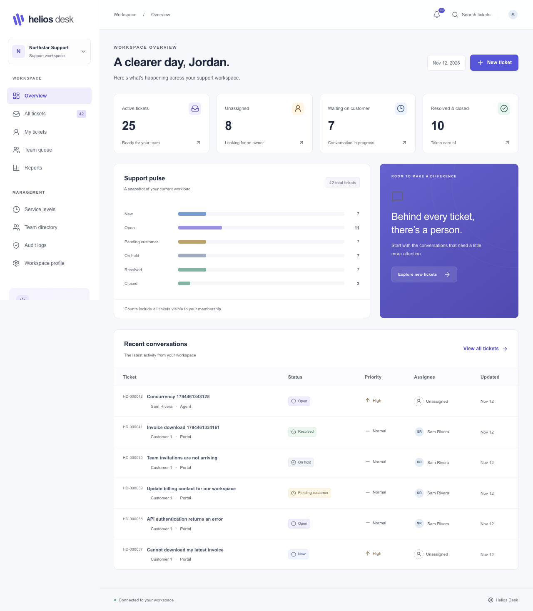
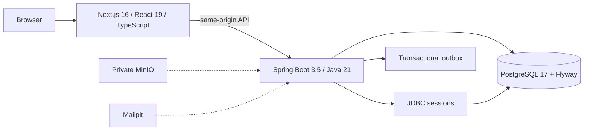

# Helios Desk

A customer-support workspace built with Next.js, Spring Boot and PostgreSQL. A working customer-to-agent ticket lifecycle, tenant isolation and concurrency controls come first.

Delivery: runnable MVP 0.1. Full v1 specification requirements remain open in the acceptance checklist.



## Run the local demo

```sh
cp .env.example .env
docker compose --env-file .env -f infra/compose.yml up --build -d --wait
```

Open **http://localhost:3100**. Docker/Compose is required. First build compiles pinned upstream MinIO/mc source because public prebuilt images are unavailable. Everything uses local infrastructure and synthetic data.

Local dev-only password: **`HeliosDemo!2026`** (or `DEMO_PASSWORD` in `.env`). It is only loaded by the explicitly enabled dev seed; it never creates production credentials.

| Email | Role | Workspace |
| --- | --- | --- |
| owner@northstar.test | Owner | Northstar Support |
| manager@northstar.test | Manager | Northstar Support |
| agent1@northstar.test | Agent | Northstar Support |
| agent2@northstar.test | Agent | Northstar Support |
| auditor@northstar.test | Read-only auditor | Northstar Support |
| customer1@northstar.test | Requester | Northstar Support |
| customer2@northstar.test | Requester | Northstar Support |
| owner@bluepeak.test | Owner | Bluepeak Labs |
| customer1@bluepeak.test | Requester | Bluepeak Labs |

Try customer create → agent claim → private note → public reply → customer reply → agent resolution → manager audit. [Demo click path](docs/demo-script.md).

## Implemented core

- Role-aware staff workspace and customer portal, responsive inbox, search/status/priority filtering, server pagination, real aggregate counts and activity history.
- Session-cookie login/logout, CSRF, membership switching, two tenants, DB-backed authorization and composite tenant foreign keys.
- Atomic ticket counters, request replay fingerprints, concurrent claim, version preconditions, persisted public/private conversation and exact status workflow.
- Append-only events/audits; transactional outbox intent; snapshot-based SLA calendar math, pause/resume and reopen cycles.
- Durable outbox claims/retries/dead letters, per-member notifications, replayable SSE, business-calendar/policy editor, versioned team management and computed SLA/workload reports.
- Server-rendered Markdown with an OWASP allowlist; raw HTML, scriptable URLs and remote images cannot become active content.
- Real PostgreSQL/Testcontainers unit/integration/concurrency tests and Playwright lifecycle, isolation, conflict-draft and accessibility checks.

Remaining P1/P2 requirements, P3 integrations/knowledge/CSAT and P4 operational evidence remain tracked in [progress](docs/progress.md). Phase acceptance gates are still open. This project makes no compliance/high-scale production claim.

## Architecture



A modular monolith keeps domain boundaries and reliable ACID writes without distributed transactions. [Architecture](docs/architecture.md), [ERD](docs/erd.md), [ADRs](docs/adr), [API contract](packages/api-contract/openapi.json), [security](docs/security.md), [threat model](docs/threat-model.md).

## Develop and verify

Prerequisites for native workflow: Java 21, Node 24, Docker. Maven wrapper and npm lockfile pin builds.

```sh
npm ci --prefix apps/web
docker compose --env-file .env -f infra/compose.yml up -d db minio minio-init mailpit
make api    # separate terminal
make web    # separate terminal
make test
npx --prefix apps/web playwright install chromium
npm --prefix apps/web run e2e
make contract
```

`make verify` runs unit/integration/frontend/browser checks against the running demo. `./apps/api/mvnw -f apps/api/pom.xml spotless:apply` formats Java; `npm --prefix apps/web run format` formats frontend files. Integration tests create an isolated real PostgreSQL container and need Docker. No external paid API is used.

Key evidence: [backend integration tests](apps/api/src/test/java/com/heliosdesk/TicketIntegrationTest.java), [state machine matrix](apps/api/src/test/java/com/heliosdesk/tickets/WorkflowTest.java), [calendar fixtures](apps/api/src/test/java/com/heliosdesk/servicelevels/BusinessCalendarTest.java), [browser journeys](apps/web/e2e/core.spec.ts). GitHub Actions definitions exist; hosted CI has not run until this repo is pushed.

Verified locally: 78 backend tests, 2 frontend unit tests, 8 production-container browser journeys (including a 30-second SSE disconnect), clean-volume startup and isolated PostgreSQL backup/restore. [Dated results and remaining scope](docs/progress.md).

## Repository

`apps/web` frontend; `apps/api` domain services/migrations/tests; `packages/api-contract` generated contract; `infra` local containers; `docs` design/evidence; `scripts` repeatable tools. Keep secrets/exports out of Git, preserve tenant query scopes and add regression tests for security/concurrency changes. MIT license applies to original project code; bundled runtime dependencies and upstream MinIO retain their respective licenses.

[Deployment](docs/deployment.md) · [Acceptance checklist](docs/acceptance-checklist.md) · [Known limits and next phase](docs/progress.md)
