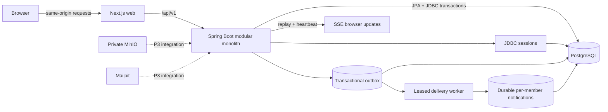

# Architecture



`identity` owns login, session context and membership reload. `tenancy` exposes tenant-scoped directories. `tickets` owns aggregate writes and authorized queues. `audit` writes redacted append-only history. `servicelevels` owns interval arithmetic and persisted cycle snapshots. `platform` owns errors, correlation IDs and idempotency.

Controllers call services. Aggregate writes share one PostgreSQL transaction across JPA and JdbcTemplate. JDBC writes cannot refer to new JPA IDs until the aggregate is flushed. Read projections exclude internal fields before JSON serialization.

```mermaid
sequenceDiagram
 participant Browser
 participant Service as Ticket service
 participant DB as PostgreSQL
 Browser->>Service: POST ticket + CSRF + Idempotency-Key
 Service->>DB: Begin transaction; acquire scoped advisory lock
 Service->>DB: Read replay fingerprint or allocate counter
 Service->>DB: Insert ticket, message, SLA cycle, event, audit, outbox
 Service->>DB: Save replay response; commit
 Service-->>Browser: Persisted ticket + ETag
```

Row locks protect claim decisions. `@Version` and `If-Match` prevent stale edits. Advisory hash collisions only serialize unrelated operations; scoped unique keys still determine correctness. Messages/events/audits have DB triggers preventing updates/deletes. Operational retention requires a separately reviewed migration/role.

`notifications` owns sequenced inbox delivery and authorized replay. `reporting` computes scoped SQL aggregates. The worker commits notification delivery before conditional outbox acknowledgement; a crash between those steps replays safely using recipient/event uniqueness. Expired leases become eligible for another worker, with claim tokens preventing stale acknowledgements. Eight failed attempts end in dead-letter state; retry delays are bounded exponential backoff with jitter.

No RLS, Redis, external paid API, global platform-admin read path or distributed transaction is used. See progress.md for implementation boundaries; P3 modules are not implied by infrastructure presence.
