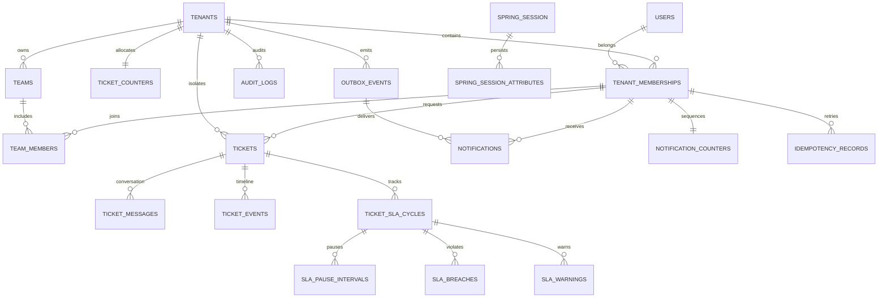

# Core physical schema

Tenant-owned references use `(tenant_id,id)` unique keys and composite foreign keys, including requester, assignee, team, message author and SLA cycle. Every queue/search predicate starts with tenant and role scope. Queue order is `(last_activity_at DESC,id DESC)`, encoded as an opaque keyset cursor. Public full-text message search uses a partial GIN index.

SLA policy JSON stores a bounded calendar and priority target configuration; each cycle snapshots it. This intentionally uses fewer normalized configuration tables than the suggested physical schema, preserving immutable historical behavior. See migrations for authoritative constraints.
